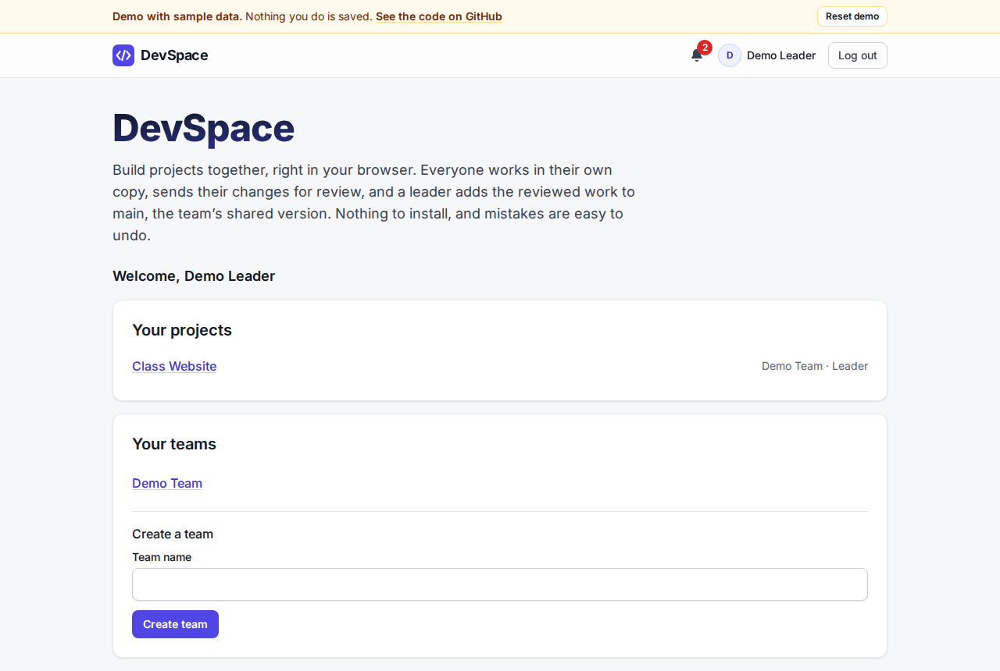
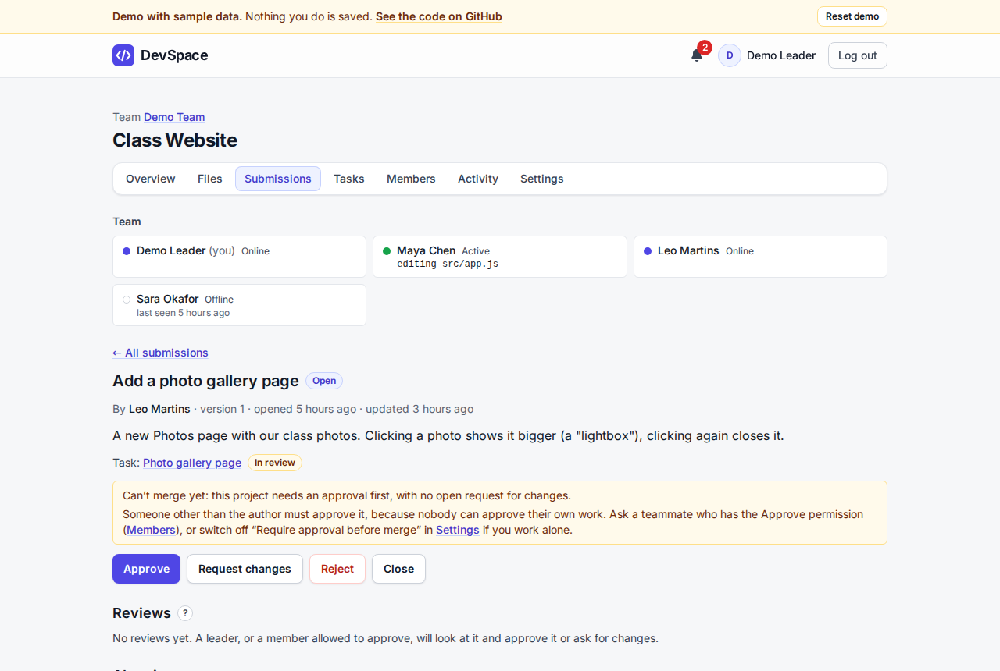
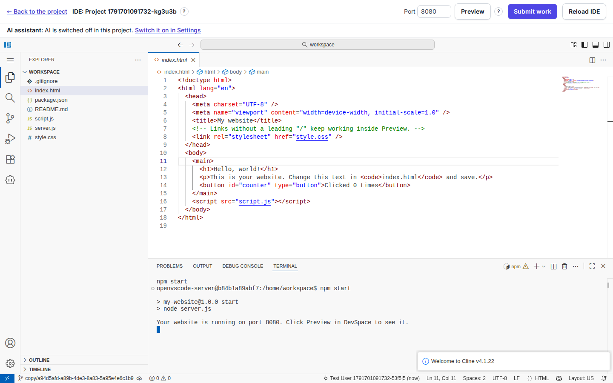
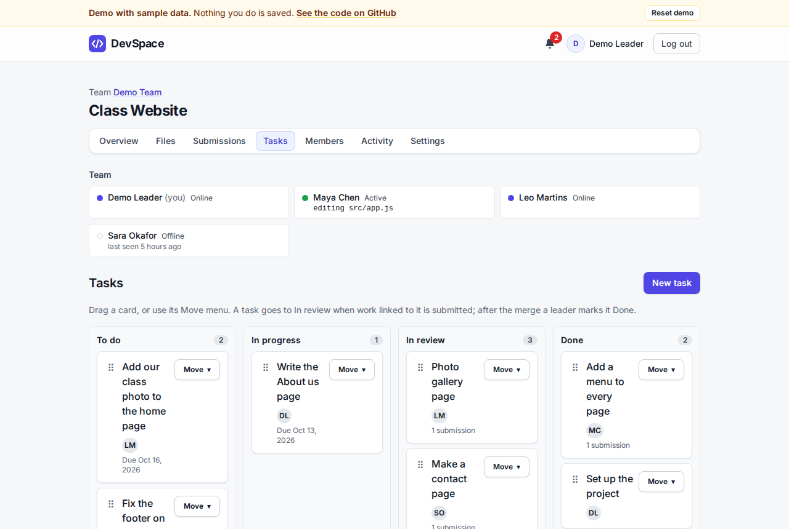

# DevSpace

**A team coding workspace for beginners, in the browser.** A leader creates a project, each member codes in their own copy in a real VS Code in the browser, members submit their work for review, and only leaders merge it into main. Git runs underneath, but nobody has to type a Git command.

<!-- DEMO-LINKS -->



## What it does

- **Your own copy, in a real VS Code.** Every member gets an isolated OpenVSCode Server container with their copy of the project, with Node.js and Python, starter templates, a Preview button, and an AI coding assistant (Cline) ready with no setup.
- **Submit, review, merge.** Members pick the files to submit. Reviewers see a Monaco diff, leave line comments and suggested fixes, and approve. Leaders merge into main, and a merge can be undone.
- **AI cross-review.** Several free AI models (through OpenRouter) review a submission side by side. Findings that more than one model agrees on are highlighted.
- **A team board and live presence.** Tasks move to In review and Done with the work. Teammates see who is online and which file they're editing, and get in-app notifications.
- **Made for beginners.** Plain wording with no Git jargon, a self-ticking Getting started checklist, light and dark mode.
- **GitHub when you want it.** Publish a project to GitHub through a GitHub App and keep it updated after every merge, without ever force-pushing.

| Review with AI findings                | The IDE in the browser                      | Task board                           |
| -------------------------------------- | ------------------------------------------- | ------------------------------------ |
|  |  |  |

## How it's built

TypeScript everywhere, in an npm workspaces monorepo.

| Part              | Technology                                                                                   |
| ----------------- | -------------------------------------------------------------------------------------------- |
| `apps/web`        | React, Vite, React Router, TanStack Query, Zustand, Tailwind CSS (design tokens), Monaco     |
| `apps/api`        | Node.js, Express, Zod, Prisma, PostgreSQL, Socket.io with Redis, real Git on disk, dockerode |
| `apps/worker`     | BullMQ jobs: idle IDE shutdown, copy updates after merges, AI reviews, GitHub sync           |
| `packages/shared` | Zod schemas shared by the web app and the API, so request and response shapes can't drift    |
| IDE               | OpenVSCode Server in Docker, with a tracker extension and Cline                              |
| Production        | One Docker image, Caddy with HTTPS, nightly backups with a tested restore, rate limits       |
| Tooling           | ESLint, Prettier, Vitest (unit and API tests), Playwright (end-to-end), GitHub Actions       |

**Security choices worth knowing:**

- Each IDE container is limited to 1 CPU and 2 GB, has no capabilities and no Docker socket, and is firewalled from the host, the local network and other containers.
- Every copy's IDE runs on its **own address** (`<copyId>.ide.<domain>`), on a different site from the app. Code in one copy can never act as the user in DevSpace or reach another copy's IDE, and an end-to-end test proves it.
- The API never runs Git inside a member's folder. AI keys are stored encrypted and never enter an IDE; a gateway adds them on the server.

The design is in [`docs/blueprint.pdf`](docs/blueprint.pdf), and big choices are recorded in [`docs/decisions.md`](docs/decisions.md).

## Status

All 14 planned phases are built: accounts, teams and projects, repositories, copies and IDE, submissions and review, merge and undo, tasks, presence and notifications, AI review, beginner start, the built-in AI helper, GitHub, and production deployment. There's also a demo build of the web app with sample data (`VITE_DEMO=1 npm run build -w @devspace/web`) that runs on any static host.

## Getting started

You need Linux (on Windows, WSL 2 Ubuntu), Node.js 24 and Docker Engine. From Phase 5 the API starts IDE containers through Docker's local socket, so run everything on the same Linux machine as Docker.

1. Install dependencies:

   ```sh
   npm install
   ```

2. Start PostgreSQL and Redis:

   ```sh
   npm run db:up
   ```

3. Copy `apps/api/.env.example` to `apps/api/.env`, then give it your own `AI_SECRETS_KEY` (32 random bytes, base64). It encrypts members' OpenRouter keys; the API and the worker refuse to start without it. Make one per machine, never commit it, and keep it: if it changes, members must connect OpenRouter again.

   ```sh
   echo "AI_SECRETS_KEY=$(openssl rand -base64 32)" >> apps/api/.env
   ```

4. Create the tables:

   ```sh
   npm run db:migrate
   ```

5. Build the IDE image (OpenVSCode Server with Node.js 24) and create its network. At WSL boot, `/etc/wsl.conf` runs `scripts/ide-boot.sh`, which creates the network and applies the IDE firewall as root. Run it once by hand as root after setting it up. From Windows: `wsl -d Ubuntu -u root bash /home/ayush/devspace/scripts/ide-boot.sh`.

   ```sh
   npm run ide:build
   npm run ide:network
   ```

6. Start the web app, the API and the worker (which stops IDEs idle for 30 minutes and checks copy sizes):

   ```sh
   npm run dev
   ```

   Open http://localhost:5173.

### Ports

| Address                              | What                                                                                                               |
| ------------------------------------ | ------------------------------------------------------------------------------------------------------------------ |
| `http://localhost:5173`              | The web app (`APP_ORIGIN`); Vite forwards `/api` to the API                                                        |
| `http://localhost:3000`              | The API (`PORT`)                                                                                                   |
| `http://<copyId>.ide.localhost:3100` | The IDE listener (`IDE_PORT`, `IDE_HOST`, `IDE_BASE_URL`), bound to 127.0.0.1 only; every copy has its own address |
| `http://127.0.0.1:4010`              | e2e tests only: the stand-in OpenRouter (`OPENROUTER_STUB_PORT`), a test double                                    |

Each copy's IDE is served from its own address, `http://<copyId>.ide.localhost:3100`, on purpose. The browser treats `ide.localhost` as a different site from `localhost`, so code running in a member's IDE can never act as the app, and one copy's IDE can't use another's. Browsers send every `*.localhost` name to this computer by themselves, so nothing needs to go in a hosts file. Open the app at `http://localhost:5173`. The IDE listener binds IPv4 `127.0.0.1` because WSL forwards Windows' `127.0.0.1` only to IPv4 listeners. Run `npm run ports:check` to see whether something else already holds 3000, 3100, 5173 or 4010.

## Commands

| Command                   | What it does                                                                   |
| ------------------------- | ------------------------------------------------------------------------------ |
| `npm run dev`             | Starts the web app, the API and the worker                                     |
| `npm run lint`            | Runs ESLint                                                                    |
| `npm run typecheck`       | Type-checks every workspace                                                    |
| `npm test`                | Runs unit and API tests (the API tests need the database)                      |
| `npm run test:e2e`        | Runs the Playwright browser tests                                              |
| `npm run format`          | Formats the code with Prettier                                                 |
| `npm run ide:build`       | Builds the tracker extension and the IDE image `devspace-ide:5`                |
| `npm run ide:network`     | Creates the Docker network IDE containers join                                 |
| `npm run ports:check`     | Checks that ports 3000, 3100, 5173 and 4010 are free                           |
| `npm run templates:smoke` | Runs every starter template inside the IDE image (needs the image and network) |

The e2e tests never call OpenRouter. Playwright starts a stand-in OpenRouter (`e2e/stubs/openrouter.ts`, a test double that hands out fake keys and canned findings), points the API and the worker at it with `OPENROUTER_BASE_URL`, and gives them a throwaway `AI_SECRETS_KEY`. Outside CI Playwright reuses a dev server that is already running, which keeps its own settings, so stop `npm run dev` first (or run `CI=1 npx playwright test`).

## Going live

[docs/deploy.md](docs/deploy.md) walks through putting DevSpace on your own server, step by step. The production files are in `deploy/`:

| Command                                                      | What it does                                                                                                                         |
| ------------------------------------------------------------ | ------------------------------------------------------------------------------------------------------------------------------------ |
| `bash deploy/smoke.sh`                                       | Builds the production images, runs the whole stack locally on `http://app.localhost:8088` and checks it (`--keep` leaves it running) |
| `npx playwright test -c deploy/journey/playwright.config.ts` | The full journey (sign up to merge) against a running production stack                                                               |
| `bash deploy/test-backup.sh`                                 | Proves backups and restore work, on a throwaway database                                                                             |
